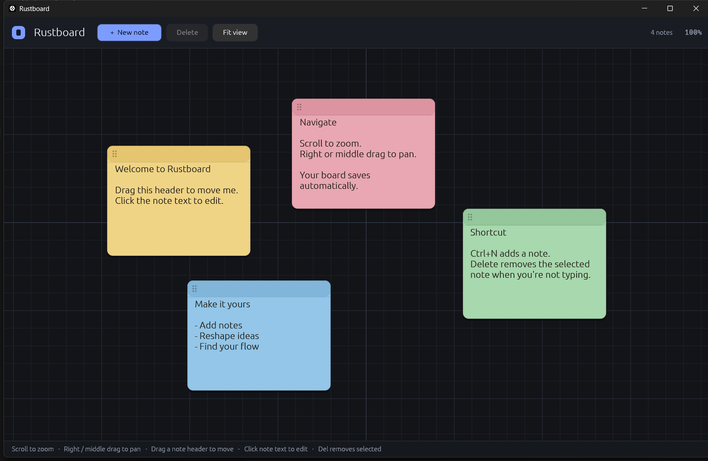

# Rustboard

**Rustboard** is the first milestone of the **alex-todo** project: a dark, infinitely pannable
canvas for sticky notes, built as a native Windows app with Rust and
[`egui`/`eframe`](https://github.com/emilk/egui) on WGPU.



## Features

- Infinite, zoomable canvas with an adaptive grid
- Dark UI with pastel sticky notes
- Inline multiline text editing on every note
- Drag a note's header to move it; dragged notes move with the pointer and come to the front
- Wheel scrolling zooms directly — no Ctrl needed — anchored under the cursor
- Hold the right **or** middle mouse button and drag to pan in 2D, including over notes
- Add, select, delete, and fit-to-content controls
- Automatic local saving of notes and camera position; restored on next launch
- Low-latency input path: raw pointer updates are applied before painting, active gestures request
  repaints, and the WGPU surface uses one queued frame with a no-vsync presentation mode

## Controls

| Input | Action |
|---|---|
| Scroll wheel | Zoom in/out under the pointer |
| Right-drag or middle-drag | Pan the canvas |
| Drag a note header | Move the note |
| Click note text | Edit the note |
| `Ctrl+N` | Add a note at the center of the view |
| `Delete` / `Backspace` | Delete the selected note when not typing |
| `+ New note` | Add a note and focus its editor |
| `Delete` button | Delete the selected note, even while editing |
| `Fit view` | Frame every note on the board |

Notes are draggable only by their header; primary dragging inside the text body is reserved for
text selection and caret placement.

## Build and run

Requirements:

- Windows 10/11
- Rust stable 1.95 or newer (tested with 1.100.0)
- MSVC C++ build tools

```powershell
cargo run --release
```

If `cargo` is not on your PATH, use the installed toolchain directly:

```powershell
$rustBin = "$env:USERPROFILE\.rustup\toolchains\stable-x86_64-pc-windows-msvc\bin"
$env:PATH = "$rustBin;$env:PATH"
& "$rustBin\cargo.exe" run --release
```

The release executable is also copied to `dist\rustboard.exe` after building.

## Tests

```powershell
cargo test
cargo clippy --all-targets -- -D warnings
cargo fmt --check
```

The suite currently has 17 tests:

- Pure model tests for seed validity, add/delete, z-ordering, bounds, RON persistence, and
  malformed-state repair
- Camera tests for coordinate round-tripping, zoom anchoring, clamping, pan direction, fit-to-view,
  and adaptive grid spacing
- An eframe storage round-trip test for the complete board + camera payload
- Headless egui interaction tests that run without opening a window. They synthesize pointer,
  wheel, keyboard, and text events through `egui::Context` and verify:
  - wheel zoom over note text keeps the point under the cursor fixed
  - right-drag and middle-drag panning work over notes
  - dragging a note header updates its position before the button is released
  - clicking note text focuses the editor and typing reaches the note
  - `Ctrl+N` adds a note

## Persistence

The board and camera are saved through eframe's persistence storage using RON under the key
`rustboard.state.v1`. Eframe manages the app-data location. Saves happen every two seconds and on
normal exit. Missing or malformed data falls back safely instead of crashing.

## Project layout

| Path | Contents |
|---|---|
| `src/app.rs` | App state, action reducer, toolbar, hint bar, shortcuts, persistence |
| `src/canvas.rs` | Custom camera-driven canvas, grid, notes, text editors, pointer input |
| `src/board.rs` | Serializable note/board model and repair rules |
| `src/camera.rs` | Camera transforms, zoom anchoring, fit-to-view, grid spacing |
| `src/theme.rs` | Dark palette and note colors |
| `src/headless_tests.rs` | Window-free egui interaction tests |
| `docs/screenshot.png` | Current UI reference |

## Current scope

This iteration is a single local board. Notes have a fixed size; there is no note resizing,
undo/redo, collaboration, accounts, sync, or AI/todo functionality yet.

## Direction

The repository is named `alex-todo` because this visual workspace is intended to grow into a
personal todo system. The current release deliberately focuses on the foundation: a fast, pleasant
infinite canvas with editable sticky notes.

## License

MIT — see [LICENSE](LICENSE).
